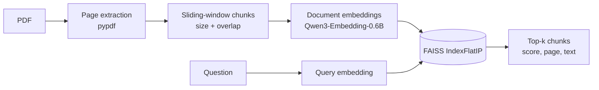

# QnA-Agent

A modular, local-first retrieval pipeline for question answering over PDFs, built from scratch in Python. It covers ingestion, chunking, dense embeddings, vector search and an interactive Streamlit sandbox for experimenting with chunking settings.

**Status: `v0.1.0`, a retrieval baseline.** The pipeline finds and ranks the passages that answer a question, with page numbers. Answer generation, hybrid search, reranking and evaluation are planned (see the [roadmap](#roadmap)).

## What it does

1. **Ingests a PDF** and extracts text page by page, keeping page numbers.
2. **Chunks** each page with a character-based sliding window (configurable size and overlap).
3. **Embeds** every chunk with `Qwen/Qwen3-Embedding-0.6B` through `sentence-transformers`, using separate document and query encoders (asymmetric retrieval). Vectors are L2-normalised.
4. **Searches** with an exact inner-product index (`FAISS IndexFlatIP`), which equals cosine similarity on normalised vectors.
5. **Returns the top-k chunks** with score, source name, page number and chunk id.

## Architecture



```text
QnA-Agent/
├── app.py            # Streamlit sandbox: upload a PDF, tune chunking, inspect retrieved chunks
├── pyproject.toml    # Dependencies, managed with uv
├── uv.lock           # Locked dependency versions
└── src/
    ├── chunker.py    # PDF page extraction and overlapping character-based chunking
    ├── retriever.py  # Model loading, embedding generation, FAISS index and search
    └── pipeline.py   # Ties ingestion and querying together
```

## Quickstart

Requires Python 3.12 or later and [uv](https://docs.astral.sh/uv/).

```bash
git clone https://github.com/kasimkhan06/QnA-Agent.git
cd QnA-Agent
uv sync
uv run streamlit run app.py
```

Then, in the browser:

1. Upload a PDF in the sidebar.
2. Choose a chunk size and overlap, then click **Build / Rebuild Index**.
3. Ask a question and inspect the top-k chunks, their scores and page numbers.

The embedding model is downloaded from Hugging Face the first time you run it.

To try the pipeline from the command line, put a PDF in `data/`, set its path in the `__main__` block of `src/pipeline.py`, and run:

```bash
uv run python -m src.pipeline
```

## Settings

| Setting | Default in the app | Where |
| --- | --- | --- |
| Chunk size | 800 characters (200 to 2000) | sidebar slider |
| Chunk overlap | 120 characters (0 to 500) | sidebar slider |
| Top-k | 5 (1 to 15) | sidebar slider |
| Embedding model | `Qwen/Qwen3-Embedding-0.6B` | `src/retriever.py` |
| Index | `FAISS IndexFlatIP` (exact search) | `src/retriever.py` |

Chunks shorter than 40 characters are dropped, which removes most stray headers and footers.

## Example

I developed it against a long English-language book, so questions like this work well:

> *What happened during the Treaty of Hudaybiyyah?*

Each result shows the cosine score, the page and the passage, so you can check the answer against the source.

## Known limitations

- Character-based chunking can cut a sentence in half. Sentence- or section-aware chunking is planned.
- Search is dense-only, so exact names and rare terms can be missed. Hybrid search is planned.
- There is no reranker yet and no answer generation. The output is retrieved passages, not a written answer.
- Metadata is page-level only. Chunks do not know their chapter or heading.
- Exact search is fine for one book. A larger corpus would need an approximate index such as HNSW.

## Roadmap

- [x] `v0.1.0`: PDF ingestion, chunking, dense retrieval, Streamlit sandbox
- [ ] Evaluation set (labelled questions with the correct page) and recall@k and MRR scoring
- [ ] Sentence- and section-aware chunking, compared against the baseline on the evaluation set
- [ ] Hybrid retrieval (BM25 plus dense) with reciprocal rank fusion
- [ ] Cross-encoder reranking
- [ ] Grounded answer generation with page citations, and a refusal when the answer is not in the document
- [ ] FastAPI service and Docker image

## Using your own documents

Place your PDF anywhere and upload it in the app. Do not commit documents you do not have the right to redistribute.

## Tech stack

Python 3.12, `pypdf`, `sentence-transformers`, `faiss-cpu`, `numpy`, `streamlit`, `uv`.

## License

Released under the license in [LICENSE](LICENSE).
